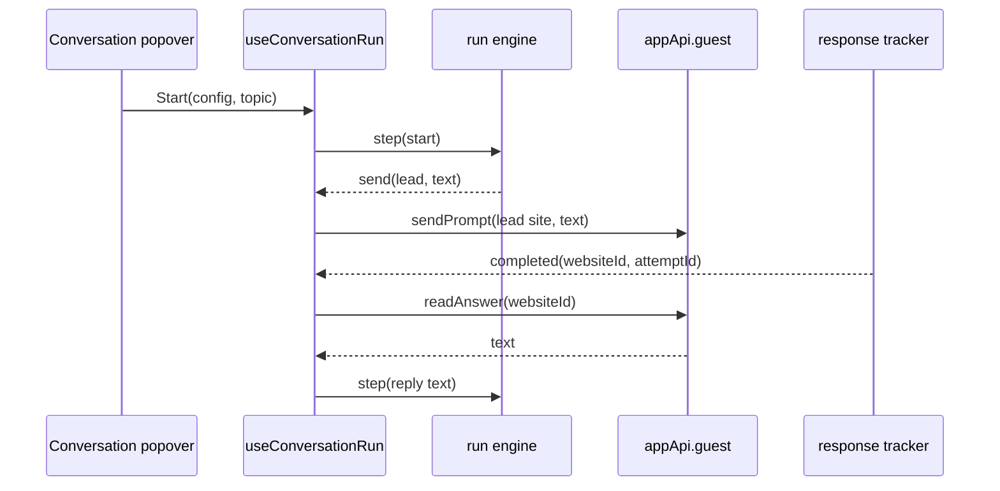

# Start a conversation

**Feature: [conversation](README.md)** · Status: todo · Depends on: [read-answer-text](001-read-answer-text.md), [run-engine](003-run-engine.md)

**Docs:** [conversation-flow](../../../docs/001-conversation/conversation-flow.md#setup), [one round](../../../docs/001-conversation/conversation-flow.md#one-round)

## Goal

From the **Conversation** popover you pick a lead, ordered reviewers and a round limit, press **Start**, and the browsers discuss the prompt box text until the run ends. **Stop** ends it.

## Design

- **Settings:** add `conversation: { leadId: string; reviewerIds: string[]; maxRounds: number }` to `AppSettings` in [settings.ts](../../../packages/multi-mind/src/settings.ts), with normalising (unknown ids dropped, `maxRounds` clamped 1–20, default 5) and a settings test.
- **Send text to one browser from code:** today `sendPrompt` in [App.tsx](../../../apps/desktop/src/windows/main/App.tsx) always reads the prompt box, applies presets, clears the box and records history. Extract a `sendTextTo(website, text)` that only does the attempt id, `beginResponse` and `appApi.guest.sendPrompt`; `sendPrompt` uses it. Conversation turns are not recorded in search history ([open decisions](../../../docs/001-conversation/conversation-flow.md#open-decisions) question 4).
- **Topic:** the prompt box text with ticked presets applied, the same composition as **Submit**. Box cleared on Start.
- **Run hook** `apps/desktop/src/windows/main/conversation/useConversationRun.ts`: maps engine speakers to websites (lead = `leadId`, Reviewer N = `reviewerIds[N-1]`), runs effects, and on `useAiResponseCompleted` for the current speaker's attempt calls `readAnswer` and steps the engine.
  - Gap: the tracker emits completions only. Failures and cancellations (`failed`, `cancelled`, timeout) must also reach the hook as a `failed` event — add a matching subscription in [response-events.ts](../../../apps/desktop/src/windows/main/response-completion/response-events.ts).
  - Empty `readAnswer` text → `failed` ("could not read the answer").
- **Popover** ([SendToOneButton.tsx](../../../apps/desktop/src/windows/main/components/SendToOneButton.tsx), rename to `ConversationButton.tsx`): Lead select, Reviewers as an ordered list of the other open browsers with include checkbox and up/down buttons, Max rounds number, **Start** (disabled with no lead, no reviewer or empty topic). Site names appear here only — they never reach a message.
- "Send only to": per [open decisions](../../../docs/001-conversation/conversation-flow.md#open-decisions) question 2 (recommended: its own button next to Conversation).
- **While running:** **Submit** becomes **Stop**; a status line shows "Round 2 of 5 · Reviewer 1 writing"; closing a participating browser asks to stop the run first. Paused shows its reason with **Stop** only — Retry and Skip come in [transcript-and-pauses](005-transcript-and-pauses.md).
- Use shadcn components from `@pixpilot/shadcn-ui` (tailwind-shadcn skill).

## Done when

- [ ] unit: settings normalising for `conversation` (missing, unknown ids, out-of-range rounds).
- [ ] unit: `useConversationRun` with a fake guest API and tracker — completion → read → next send to the right website; failure event → paused; Stop cancels pending sends.
- [ ] unit: `sendPrompt` behaviour unchanged after extracting `sendTextTo` (existing tests pass).
- [ ] live: Claude as lead, ChatGPT and Gemini as reviewers, a short topic → messages go lead → Reviewer 1 → Reviewer 2 → lead, and the run ends on `[[FINAL]]` or the limit.
- [ ] live: none of the messages typed into the sites contains a site name.
- [ ] live: **Stop** mid-run ends it; no further message is sent.
- [ ] live: setup is the same after restarting the app.

## Open questions

- Where does "Send only to" go? See [open decisions](../../../docs/001-conversation/conversation-flow.md#open-decisions) question 2. Recommended: its own button.
