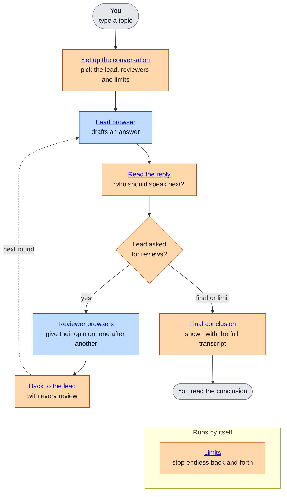

# Conversation

[← Docs index](../README.md) · Tasks: [conversation](../../.ai/tasks/001-conversation/README.md)

Several AI browsers discuss one topic: a lead browser owns the answer and asks reviewer browsers for their opinion, turn by turn, until it gives a final conclusion or a limit is reached.

Orange: the app (main window) decides and routes. Blue: the AI sites in their browsers do the thinking. Grey: you.

Reading order:

1. [conversation-flow](conversation-flow.md): roles, rounds, setup, limits and how a conversation ends
2. [handoff-protocol](handoff-protocol.md): what each browser is told, the reply tags, and what gets passed on
