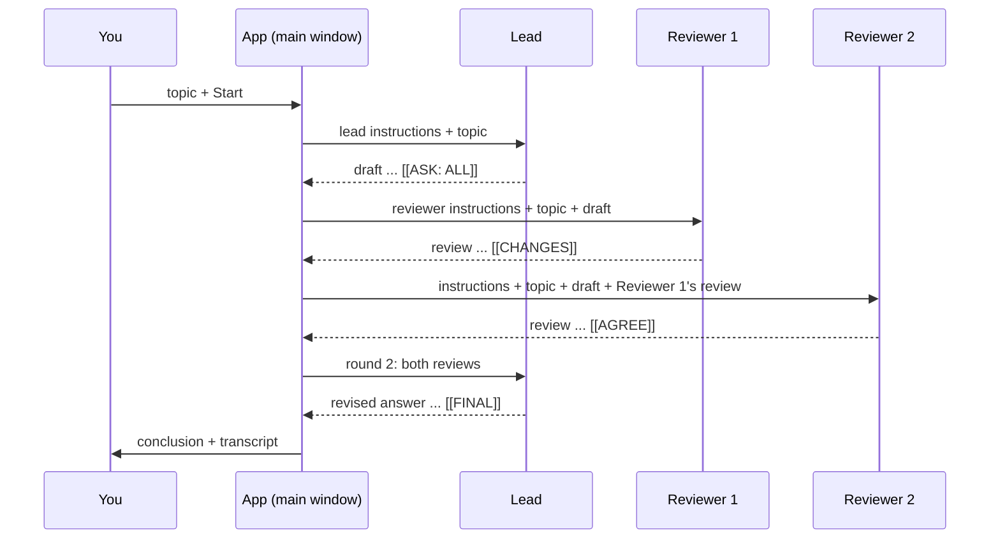
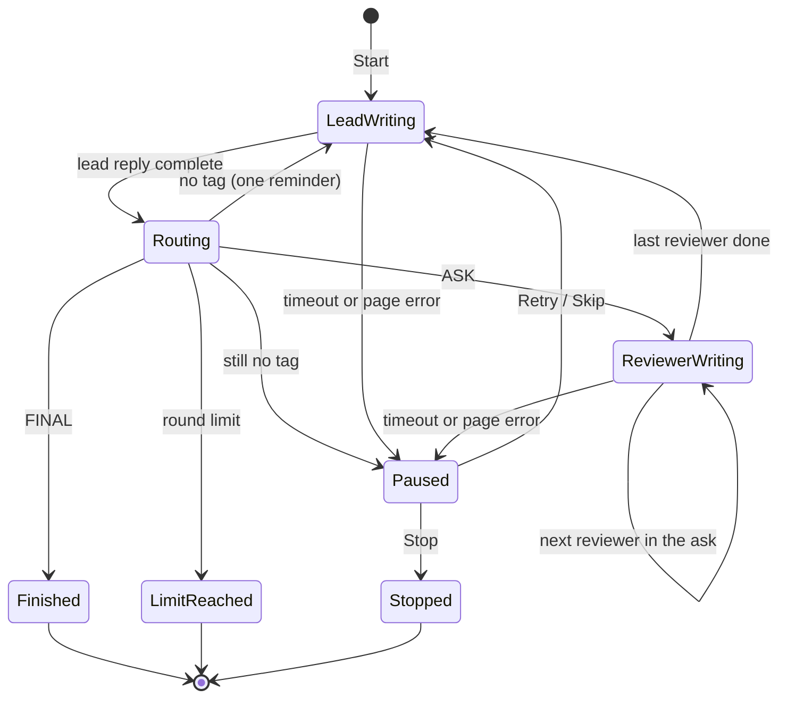

# Conversation flow

[← Conversation map](README.md)

How a conversation between browsers runs: who takes part, the order they speak in, and what stops it.
Rule: **only one browser works at a time, and the app — never the AIs — decides who speaks next, based on a tag at the end of the lead's reply.**

## Roles

| Role         | How many    | What it does                                                                   |
| ------------ | ----------- | ------------------------------------------------------------------------------ |
| **Lead**     | exactly one | Owns the answer. Drafts, asks reviewers, revises, and writes the final answer. |
| **Reviewer** | one or more | Critiques the lead's draft. Never ends the conversation.                       |
| You          | —           | Pick the roles, type the topic, can stop the run at any time.                  |

- Reviewers have a fixed order: **Reviewer 1, Reviewer 2…**, set in [Setup](#setup).
- The lead is told how many reviewers exist, by number only, so it can ask for a specific one.
- No message names a site, model or company; every browser is only "the lead" or "Reviewer N". See [handoff-protocol](handoff-protocol.md#anonymity).
- Open browsers that are not in the conversation are left alone.

## One round

A round is one lead reply plus the reviews it asked for. The app chains the reviewers in order and returns everything to the lead in one message.

- "Finished" for each step is the existing response-completion signal ([response-completion](../../apps/desktop/src/windows/main/response-completion/)). The app sends the next message only after it fires.
- The lead can ask for one reviewer (`[[ASK: 3]]`), several in a chosen order (`[[ASK: 2, 1]]`) or all (`[[ASK: ALL]]`). Tags: [handoff-protocol](handoff-protocol.md#reply-tags).
- Each browser keeps one chat thread for the whole conversation, so later messages carry only what is new.

## Run states

- **Paused** waits for you: **Retry** resends the same message, **Skip** (reviewers only) continues without that review, **Stop** ends the run.
- **Stop** works in every state; the browser that is mid-answer is left to finish on its own.

## Setup

In the **Conversation** popover beside **Submit**:

| Field         | Default    | Notes                                                                 |
| ------------- | ---------- | --------------------------------------------------------------------- |
| Lead          | first open | Any open browser.                                                     |
| Reviewers     | all others | Ordered list (drag to reorder) — the order becomes Reviewer 1, 2…     |
| Max rounds    | 5          | 1–20. A round = one lead reply. See [Limits](#limits).                |
| Final summary | on         | Asks the lead to end with a short conclusion block above `[[FINAL]]`. |
| **Start**     | —          | Sends the topic in the prompt box to the lead, with active presets.   |

- The setup is saved in `settings.json` and used again next time.
- While a run is active the prompt box shows **Stop** instead of **Submit**, and the participating browsers cannot be closed.

## Limits

Two AIs can agree to keep "improving" forever, so the app enforces limits regardless of what they ask.

| Limit               | Value                                 | When hit                                                                |
| ------------------- | ------------------------------------- | ----------------------------------------------------------------------- |
| Max rounds          | setup, default 5                      | The lead's last round message says "last round — end with `[[FINAL]]`". |
| Hard stop           | max rounds reached, no FINAL          | Run ends as **Limit reached**; the lead's last reply is the result.     |
| Missing tag         | 1 reminder per reply                  | Second miss → **Paused**.                                               |
| Reply timeout       | completion detector's 15 min          | **Paused**.                                                             |
| Reviewer per ask    | each reviewer at most once            | Duplicate numbers in one `ASK` are dropped.                             |
| Forwarded text size | see [open decisions](#open-decisions) | Long replies may exceed a site's input limit.                           |

- The round counter is shown in every lead message ("Round 2 of 5") so the lead can plan.

## Ending a conversation

| Ending            | Result shown                                     |
| ----------------- | ------------------------------------------------ |
| **Finished**      | The lead's final reply (text above `[[FINAL]]`). |
| **Limit reached** | The lead's last reply, marked as not concluded.  |
| **Stopped**       | The transcript so far.                           |

The transcript lists every turn: round, speaker, tag, and the text read from the page. It can be copied in one click.

## What the app needs that it does not have yet

- **Read the answer text.** Completion detection only reports _that_ a site finished; it never reads the answer ([types.ts](../../packages/multi-mind/src/response-completion/types.ts)). A new browser action must return the text of the last element matching the site's `responseSelector`.
- **Send a message to one browser from code**, without the prompt box. Today's single-browser send ([App.tsx](../../apps/desktop/src/windows/main/App.tsx) `runPromptOn`) sends whatever is in the prompt box.
- **A conversation runner** in the main window: holds the run state above, the transcript, and listens to `useAiResponseCompleted`.
- **Setup and transcript UI**: the Conversation popover and a transcript panel.

## Decisions

- One browser at a time — each reviewer builds on the ones before it, and the lead gets every review together.
- The app routes, not the AIs — the AIs only write a tag; they cannot reach each other directly.
- Only the lead can end the run (`[[FINAL]]`) — one owner for the answer avoids two browsers declaring different conclusions.
- Reviewer verdicts (`[[AGREE]]` / `[[CHANGES]]`) are passed to the lead but never route — the lead decides what to do with them.
- Hard round limit, not "until everyone agrees" — agreement is not reliable enough to stop on.
- Browsers are anonymous to each other — prompts say "the lead" and "Reviewer N", never a site or model name.

## Open decisions

A _round_ is one lead reply plus the reviews it asked for. _Forwarded text_ is a reply the app copies from one browser into another.

1. Should a reviewer see the earlier reviewers' replies from the same round? Recommended: yes.
   - Example: Reviewer 1 says "the cache key is wrong". With yes, Reviewer 2 can confirm or argue; with no, Reviewer 2 may spend its turn finding the same thing.
2. Where does the old "Send only to" list go? Options: a small section at the top of the new Conversation popover, or its own button. Recommended: its own button.
   - Example: today you pick "Claude" in the Conversation popover to send only there. With its own button, the Conversation popover is only for setting up a discussion.
3. What happens when forwarded text is too long for a site's input box? Options: send it all and pause if sending fails, or cut it to a set length with "(truncated)". Recommended: send it all and pause.
   - Example: the lead writes 6,000 words. "Pause" stops and lets you Retry or Skip; "cut" sends the first part and the reviewer never sees the end.
4. Should a finished conversation be saved in search history? Recommended: not in the first version.
   - Example: with yes, searching "cache key" later finds the run and reopens every browser's chat; with no, you copy the transcript yourself.
5. Can the lead end the run in round 1 without asking any reviewer? Recommended: no.
   - Example: the lead answers and writes `[[FINAL]]` straight away. With no, the app replies "ask at least one reviewer first"; with yes, the run ends with no review.
