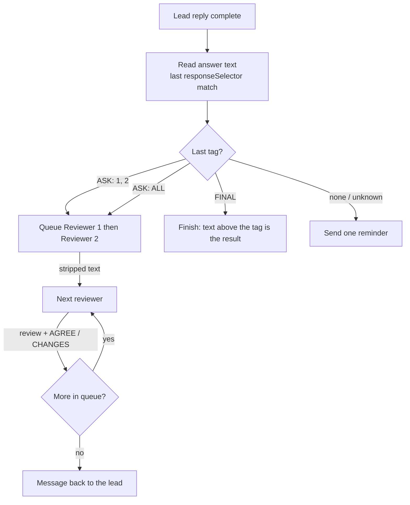

# Handoff protocol

[← Conversation map](README.md)

What the app writes into each browser, the tags the AIs must end their replies with, and what text is passed from one browser to the next.
Rule: **every lead reply ends with exactly one tag on its last line; the app reads the last tag, strips all tags from the text, and forwards the rest. No message ever says which site or model anyone is.**



## Anonymity

The AIs only ever know each other by role: **the lead**, **Reviewer 1**, **Reviewer 2**…

- No message the app writes contains a site name, model name, company or URL — not in the instructions, the headers, or the reminders.
- Site names stay in the app's own UI (setup, transcript), which only you see.
- Text written by the AIs is forwarded as-is; the app does not try to scrub names an AI writes about itself.

## Reply tags

| Tag             | Who writes it | Meaning                                              |
| --------------- | ------------- | ---------------------------------------------------- |
| `[[ASK: 1]]`    | lead          | Send my reply to Reviewer 1.                         |
| `[[ASK: 2, 1]]` | lead          | Send to these reviewers, in this order.              |
| `[[ASK: ALL]]`  | lead          | Send to every reviewer, in setup order.              |
| `[[FINAL]]`     | lead          | My answer is complete; the text above is the result. |
| `[[AGREE]]`     | reviewer      | I accept the draft as it is.                         |
| `[[CHANGES]]`   | reviewer      | I want changes (listed in my review).                |

## Reading the tag

- Text comes from the last element matching the site's `responseSelector` — the same selector completion detection uses ([websites.ts](../../packages/multi-mind/src/websites.ts)).
- Match: `/\[\[\s*(ASK|FINAL|AGREE|CHANGES)\s*(?::\s*([^\]]+))?\]\]/gi`; use the **last** match in the text, so tags the AI quotes earlier don't count.
- `ASK` targets are split on commas; each target's number is taken from its digits, so `2`, `R2` and `Reviewer 2` all mean Reviewer 2. `ALL` (any case) means every reviewer. Out-of-range numbers (`7` with 3 reviewers) and duplicates are dropped; if none remain the reply counts as having no tag.
- Every tag is removed from the text before it is forwarded, so a reviewer never sees `[[ASK: …]]` and can't trigger routing by quoting it.
- A reviewer reply with no verdict tag is still forwarded, marked `(no verdict)`. Reviewer tags never route.

## First message to the lead

Sent once, at the start, with the topic from the prompt box (presets applied):

```text
You are the LEAD in a discussion with other AI assistants. You own the final answer.

There are 2 reviewers: Reviewer 1 and Reviewer 2.

How this works:
- Work on the topic below. Before your final answer, ask at least one reviewer.
- End EVERY reply with exactly one tag on its own last line:
  [[ASK: 1]]       send this reply to Reviewer 1
  [[ASK: 1, 2]]    send it to these reviewers, in this order
  [[ASK: ALL]]     send it to every reviewer
  [[FINAL]]        your answer is complete; put the final conclusion above the tag
- Reviewers' replies come back to you in one message.
- You have at most 5 rounds. This is round 1 of 5.

Topic:
<prompt box text>
```

## Message to a reviewer

First time a reviewer is asked:

```text
You are Reviewer 2 in a discussion led by another AI (the LEAD).
There are 2 reviewers in total. Only the lead writes the final answer.

Review the lead's reply: point out mistakes, risks, missing parts and better options.
Don't rewrite the whole answer. End with exactly one tag on its own last line:
[[AGREE]] if it is good as it is, or [[CHANGES]] if it needs changes.

Topic:
<prompt box text>

Lead's reply (round 1):
<lead text, tags removed>

Earlier reviews this round:
Reviewer 1 [CHANGES]:
<review text>
```

- Later rounds drop the instructions and the topic: `Lead's reply (round 3):` plus earlier reviews this round.
- The "Earlier reviews" block appears only when an earlier reviewer has spoken in this round (see [open decisions](conversation-flow.md#open-decisions)).

## Message back to the lead

Sent after the last reviewer in the ask finishes:

```text
Round 2 of 5. Reviews of your last reply:

--- Reviewer 1 [CHANGES] ---
<review text>

--- Reviewer 2 [AGREE] ---
<review text>

Revise or answer the reviews, then end with one tag.
```

On the last round the final line becomes:

```text
This is your LAST round. Write your final answer and end with [[FINAL]].
```

## Reminder for a missing tag

Sent once when a lead reply has no valid tag; it does not count as a round:

```text
Your last reply did not end with a tag. Reply with only the tag you meant:
[[ASK: 1]], [[ASK: 1, 2]], [[ASK: ALL]] or [[FINAL]].
```

The answer to the reminder is matched for a tag only; the routed text is the reply before it.

## Decisions

- Tags in double square brackets — rare in normal writing and left untouched by markdown rendering.
- Reviewers known only by number, never by site — no AI learns which product it is talking to, so none can defer to or dismiss a reviewer because of its brand.
- Lenient target parsing (`2`, `R2`, `Reviewer 2`) — AIs paraphrase tags; reading the digits is enough.
- Last tag wins — AIs often repeat the instructions or quote earlier text.
- Instructions sent only on the first message to each browser — the chat thread already holds them, and repeating them wastes the input limit.
